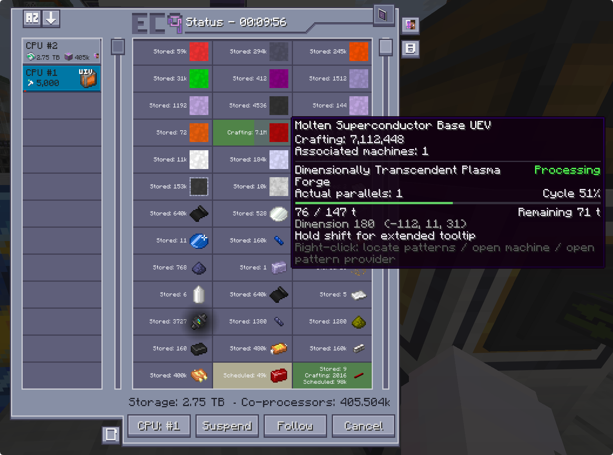
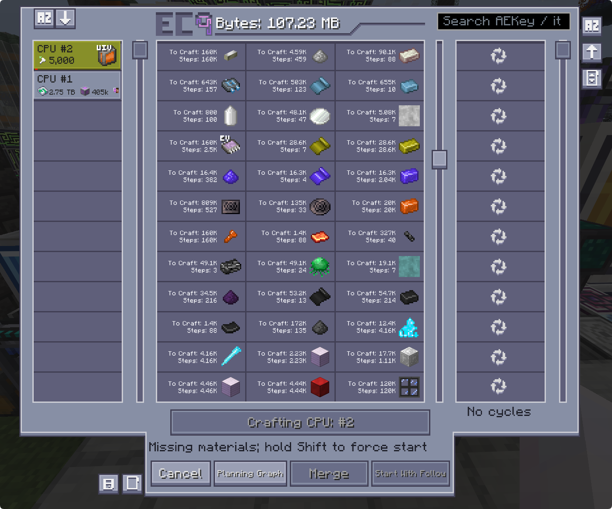
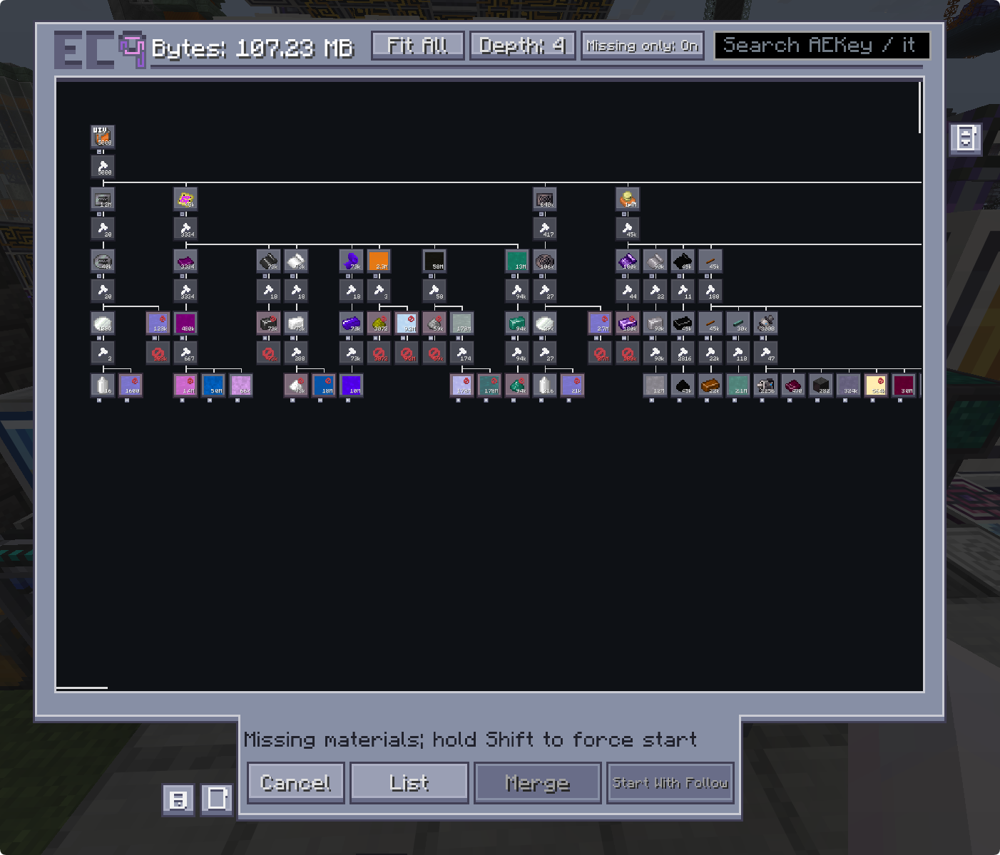
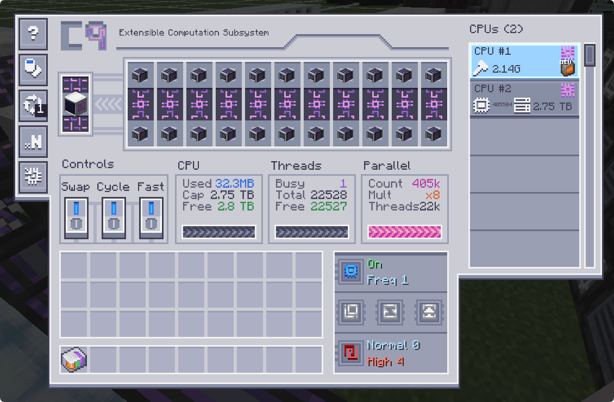
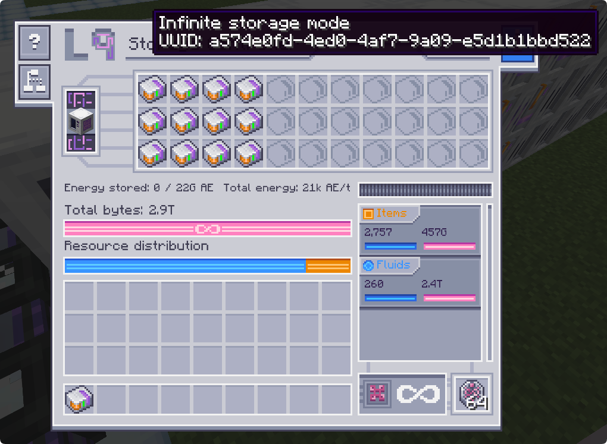
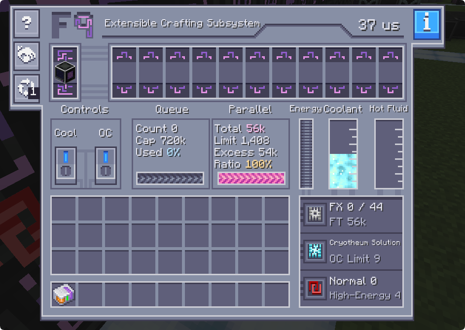

<h1 align="center">Neo ECO AE Extension</h1>

<strong>GT New Horizons · Applied Energistics 2 Addon</strong>

<a href="README.md">简体中文</a> · <strong>English</strong>

This is the official Minecraft 1.7.10 version of Neo ECO AE Extension (ECO), built for GT New Horizons.

Provides expandable storage, crafting, and computation multiblocks for ME networks, supporting centralized storage, batch manufacturing, and complex job planning.

## Version Support

<table align="center">
  <thead>
    <tr><th align="center">GTNH</th><th align="center">Download</th></tr>
  </thead>
  <tbody>
    <tr>
      <td align="center">2.9.0-RC1 and later</td>
      <td align="center"></td>
    </tr>
  </tbody>
</table>

Required dependencies include Applied Energistics 2, AE2 Fluid Crafting (AE2FC, 1.5.64-gtnh or later), ModularUI2, and StructureLib.

## Features

### Real-Time Monitoring

Monitors job inventory and processing status, showing associated machines, actual parallels, progress, remaining time, and available shutdown reasons. Supports pattern location, remote access to machines and pattern providers, and job suspension, tracking, and cancellation.

### ECO Planner

Provides fast planning, cyclic recipe handling, and large-order planning, with material requirements, inventory usage, and crafting step counts in one view. Supports CPU selection, job merging, Start With Follow, and NEI bookmarks for missing materials.

### Planning Graph

Visualizes recipe dependencies from the target output down to raw materials. Supports panning, zooming, expandable nodes, depth selection, missing-material filters, and search.

### Extensible Computation Subsystem

Provides crafting CPU threads, parallel acceleration, and job storage, with request filtering for player or automated jobs. C9 supports linked controllers to pool threads, co-processors, and job storage.

### Extensible Storage Subsystem

Provides expandable item and fluid storage with L4, L6, and L9 controllers, matrix management, resource filtering, and inventory transfers. L9 supports infinite storage mode with inventory migration and restoration.

### Extensible Crafting Subsystem

Provides pattern storage and batch crafting with independent FX execution channels, parallel expansion, overclocking, and active cooling. F9 supports linked controllers for pattern sharing and task distribution.
