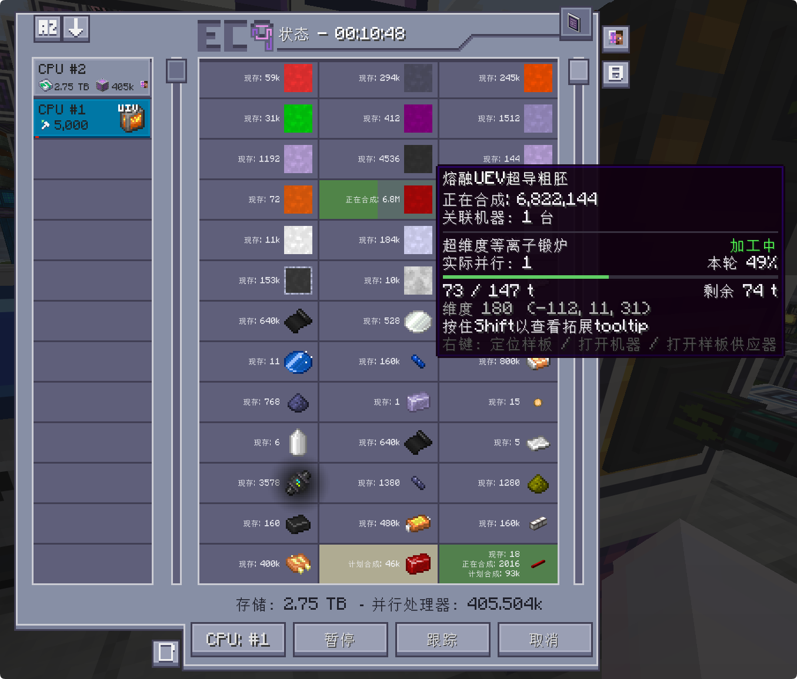
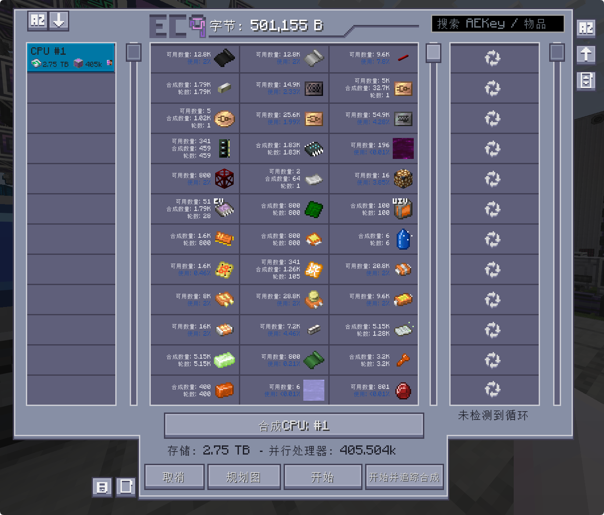
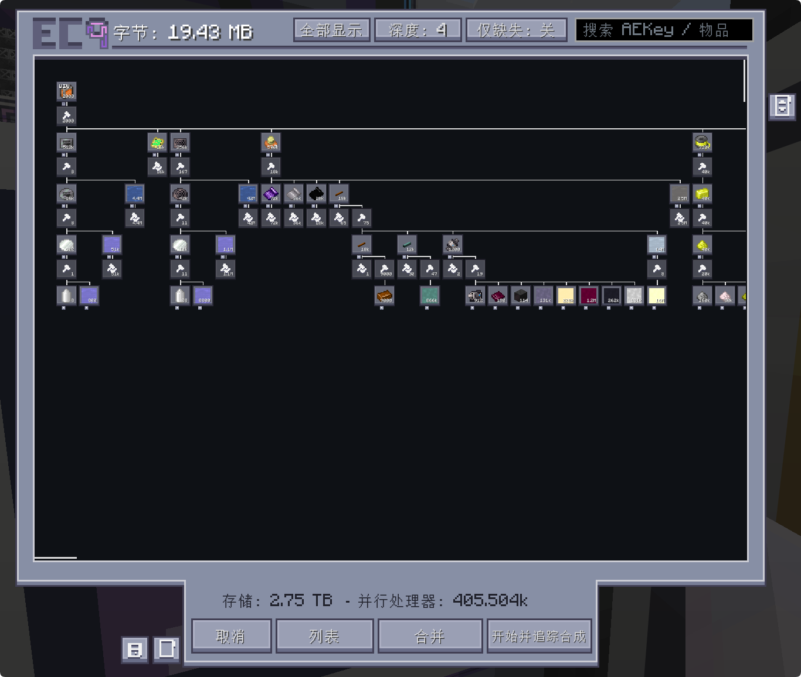
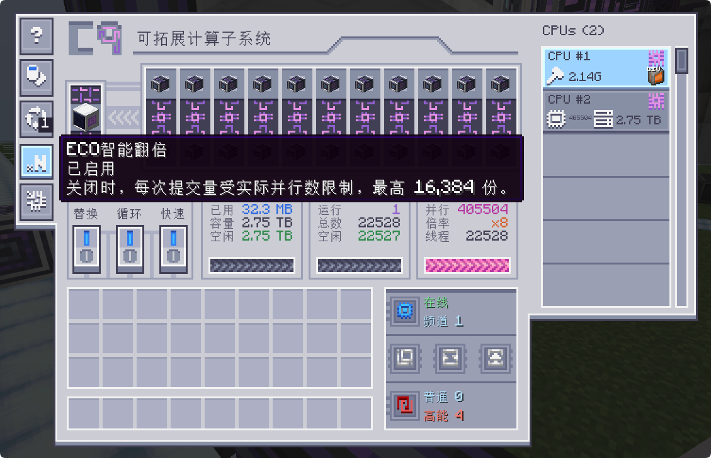
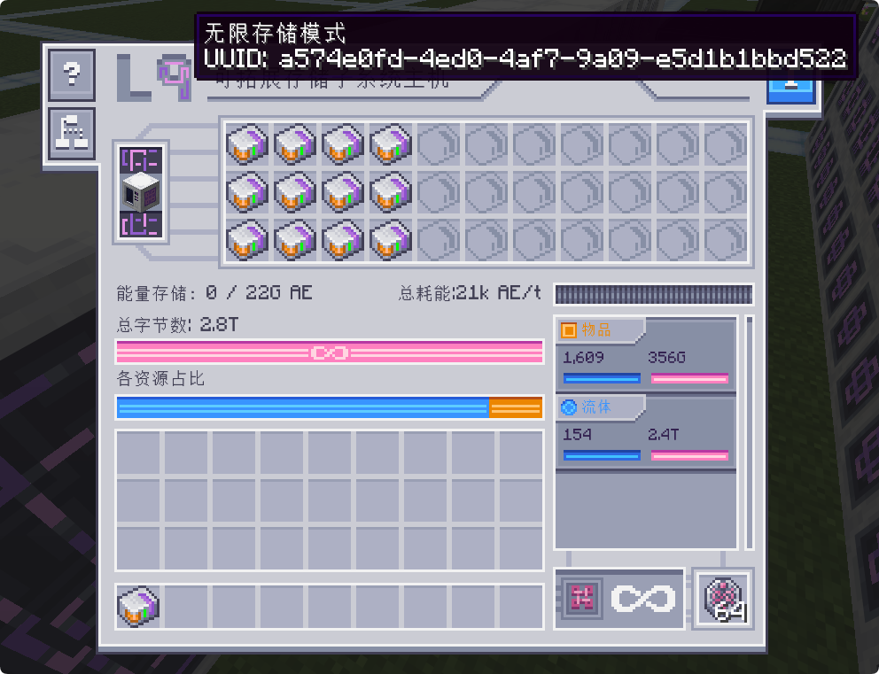
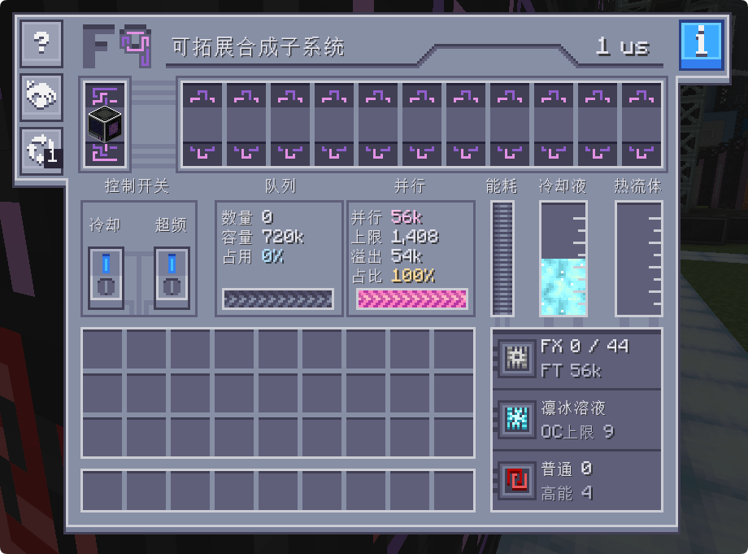

<h1 align="center">Neo ECO AE Extension</h1>

<strong>GT New Horizons · Applied Energistics 2 扩展</strong>

<strong>简体中文</strong> · <a href="README.en.md">English</a>

本项目是 Neo ECO AE Extension（ECO）的官方 Minecraft 1.7.10 版本，面向 GT New Horizons。

为 ME 网络提供可扩展的存储、合成与计算多方块，支持集中仓储、批量制造与复杂任务规划。

## 版本支持

| GTNH | 下载 |
| --- | --- |
| 2.9.0-RC1 及以上 |  |

必需前置包括 Applied Energistics 2、AE2 Fluid Crafting（AE2FC，1.5.64-gtnh 及以上）、ModularUI2 和 StructureLib。

## 功能展示

### 实时监控

提供任务库存与加工状态监控，展示关联机器、实际并行、加工进度、剩余时间及可用的停机原因。支持样板定位、远程打开机器与样板供应器，以及任务暂停、跟踪和取消。

### ECO 规划器

提供快速规划、循环配方处理与大订单规划，集中展示材料需求、库存使用和合成次数。支持 CPU 选择、任务合并、开始并跟踪，以及缺料加入 NEI 书签。

### 规划图

提供配方依赖可视化，展示从目标产物到原料的合成关系。支持拖动缩放、节点展开与收起、深度切换、缺料筛选和搜索定位。

### 可拓展计算子系统

提供合成 CPU 所需的任务线程、并行加速和存储空间，支持按玩家或自动化请求筛选任务。C9 支持多机组网，汇总线程、并行数与任务存储。

### 可拓展存储子系统

提供可扩展的物品与流体存储，支持 L4、L6、L9 三级主机、矩阵管理、资源过滤与库存转移。L9 提供无限存储模式及配套的库存迁移与恢复功能。

### 可拓展合成子系统

提供样板存储与批量合成能力，支持 FX 多通道执行、并行扩展、超频和主动冷却。F9 支持多机组网，共享样板并分配任务。
