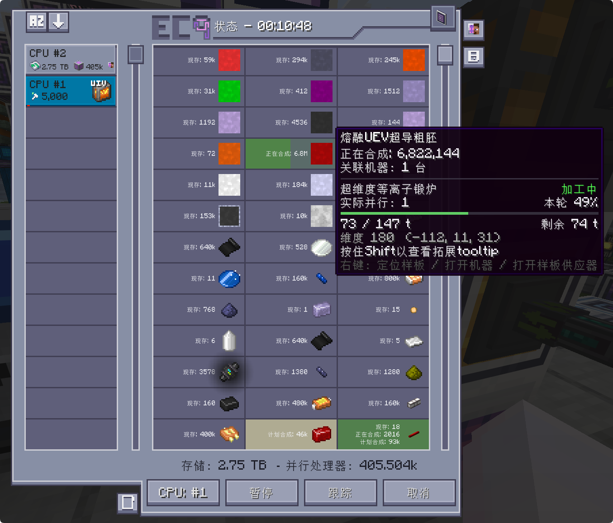
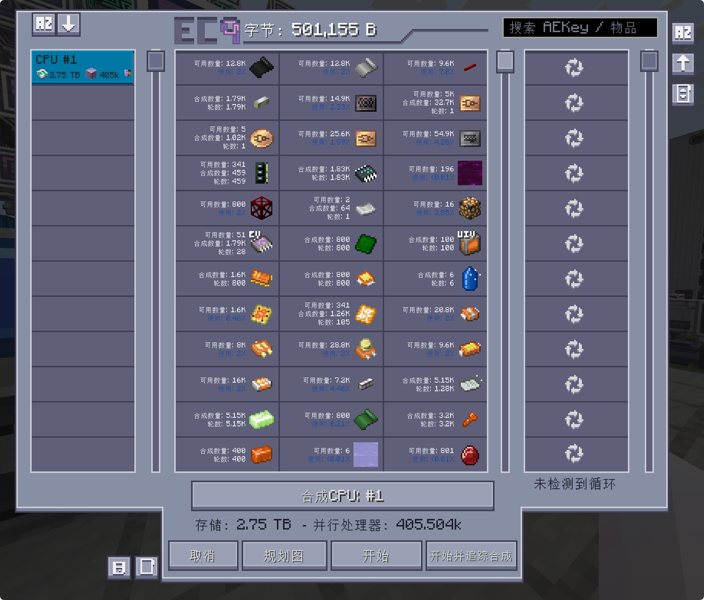
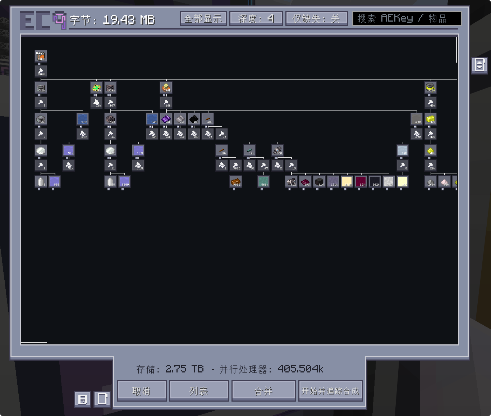
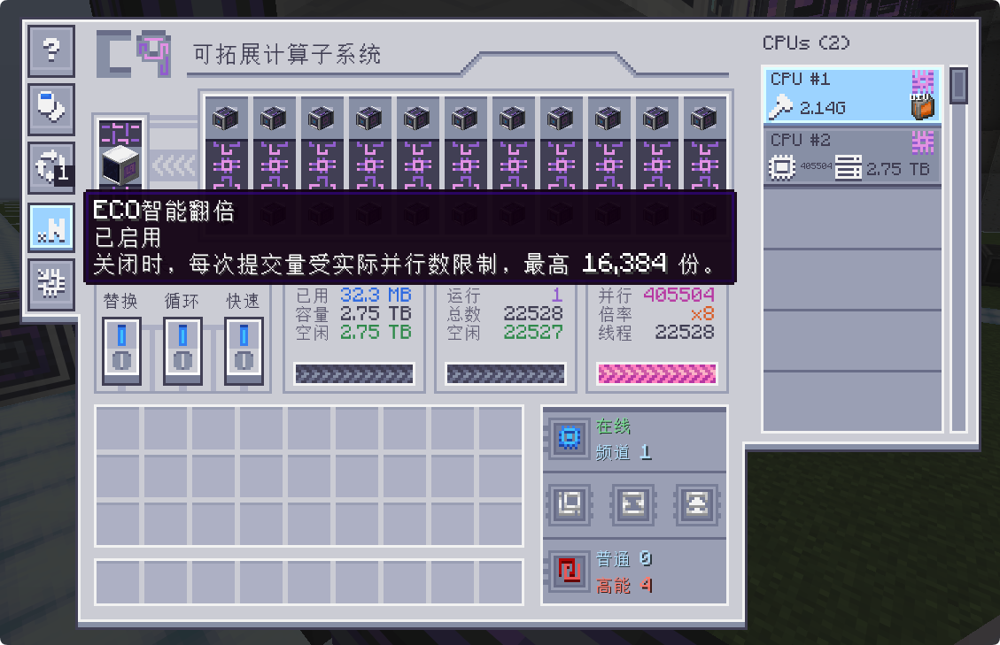
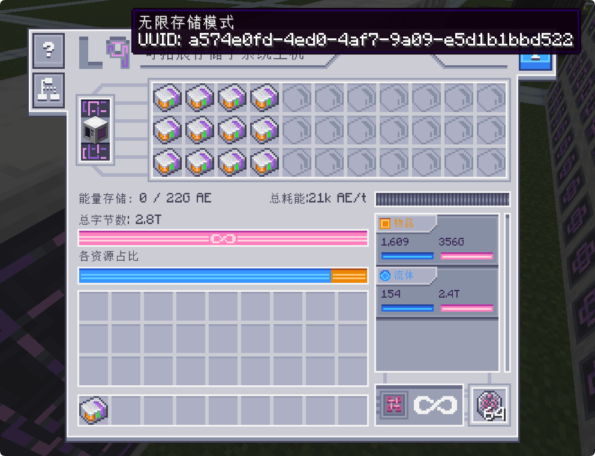
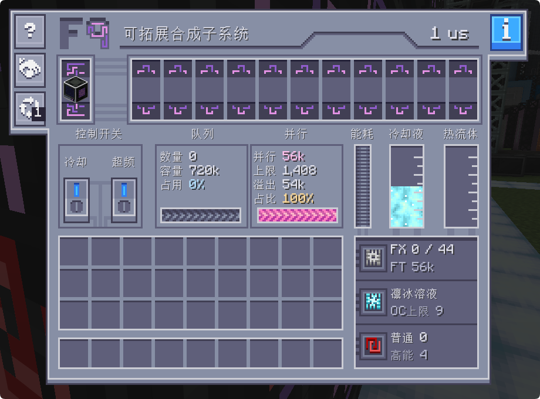

<h1 align="center">Neo ECO AE Extension</h1>

<strong>GT New Horizons · Applied Energistics 2 扩展</strong>

<strong>简体中文</strong> · <a href="README.en.md">English</a>

本项目是 Neo ECO AE Extension（ECO）的官方 Minecraft 1.7.10 版本，面向 GT New Horizons。

为 ME 网络提供可扩展的存储、合成与计算多方块，支持集中仓储、批量制造与复杂任务规划。

## 版本支持

<table align="center">
  <thead>
    <tr><th align="center">GTNH</th><th align="center">下载</th></tr>
  </thead>
  <tbody>
    <tr>
      <td align="center">2.9.0（主要目标）</td>
      <td align="center"></td>
    </tr>
  </tbody>
</table>

必需前置包括 Applied Energistics 2、AE2 Fluid Crafting（AE2FC，1.5.64-gtnh 及以上）、ModularUI2（2.3.49-1.7.10 及以上）、StructureLib 和 GTNHLib。

开发依赖以 GTNH 2.9.0 为基准。当前版本未重新验证 2.9.0-RC1 等旧候选版的兼容性。

生存进度以 GTNH 的 GregTech 配方为准：第一颗盈能水晶由 MV 电弧炉加工获得。不安装 GregTech 时，不保证能从零完成 ECO 的生存进度；本移植版不生成自有的末地矿石。

单方块集成工作站与大型集成工作站均可通过 CraftTweaker 1.7.10 脚本独立添加、删除和清空加工配方，参见 [中文接口说明与示例](docs/CRAFTTWEAKER_ZH_CN.md)。

计算子系统优先用主机或计算通讯端口接入 ME。单点接入的旧结构仍可沿用原有接线；多点接入保留原生 AE2 拓扑，避免默默切断网段。参见 [结构验收与性能对照](docs/COMPUTATION_TOPOLOGY_ZH_CN.md)。

## 功能展示

### 实时监控

提供任务库存与加工状态监控，展示关联机器、实际并行、加工进度、剩余时间及可用的停机原因。支持样板定位、远程打开机器与样板供应器，以及任务暂停、跟踪和取消。

### ECO 规划器

提供快速规划、循环配方处理与大订单规划，集中展示材料需求、库存使用和合成次数。支持 CPU 选择、任务合并、开始并跟踪，以及缺料加入 NEI 书签。

安装 NEE 后，Ctrl 补料预览与 Alt 直接补料会将多种缺失材料合并为一个临时订单，由 ECO CPU 执行，交付后自动清理。取消会停止后续下单并退回任务库存；网络暂时装不下的材料保留在 CPU 中等待交付。需要 AE2 原生规划语义的配方保留 NEE 的逐项下单流程，并适配 ECO 确认页的开始、取消及临时样板清理。

ECO 工作站配方支持 NEE 材料状态提示、补料快捷键和样板候选材料切换；存储控制器界面支持 NEI 书签批量取料与配方链库存查询。存储接口和计算接口的类型过滤槽遵循 NEE 的拖放及保留幽灵物品设置，过滤槽不保存材料数量。

### 规划图

提供配方依赖可视化，展示从目标产物到原料的合成关系。支持拖动缩放、节点展开与收起、深度切换、缺料筛选和搜索定位。

### 可拓展计算子系统

提供合成 CPU 所需的任务线程、并行加速和存储空间，支持按玩家或自动化请求筛选任务。C9 支持多机组网，汇总线程、并行数与任务存储。

### 可拓展存储子系统

提供可扩展的物品与流体存储，支持 L4、L6、L9 三级主机、矩阵管理、资源过滤与库存转移。L9 提供无限存储模式及配套的库存迁移与恢复功能。

### 可拓展合成子系统

提供样板存储与批量合成能力，支持 FX 多通道执行、并行扩展、超频和主动冷却。F9 支持多机组网，共享样板并分配任务。
