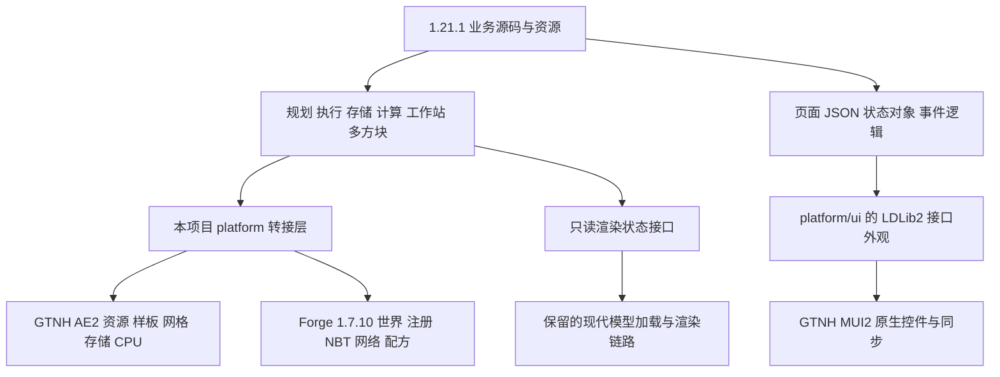

# 1.21.1 → GTNH 1.7.10 移植调查

调查日期：2026-10-25。工作区清单于当日 11:24（Asia/Shanghai）刷新。

正式业务迁入已经开始，当前实现、来源锁与运行证据见 [正式移植进度](../../porting/PROGRESS_ZH_CN.md) 和 [source-lock.json](../../porting/source-lock.json)。实际业务输入已固定为 f6003889a1352ea0d7e2e23a3868eb69943789ca。本文其余工程统计与“尚未开始”结论均属于当时的调查快照，不代表当前状态。

后续清理已移除旧业务、旧资源和旧注册入口，当前目录为移植基础骨架，详见 [当前骨架与接入说明](../../porting/README_ZH_CN.md)。本文中的旧工程规模、依赖和 69 项测试结果属于清理前快照；保留模型源码中两处业务引用已改为只读渲染接口，原始哈希仍记录在调查证据中。

基础工程已完成构建、保留模型和 JAR 内容检查，结果见 [基础工程验证记录](../../porting/foundation-state.json)。本调查保留原先提出的源码基线，正式迁入业务前仍需更新来源仓库并固定本轮实际采用的提交和补丁。

本轮已经完成源码对照、目标依赖检查及两个独立编译验证。主体业务移植尚未开始。结论是：**以 1.21.1 为业务源码输入，参考 1.20.1 的平台层结构，为 GTNH AE2 和 MUI2 建立新的转接层；旧 1.7.10 仅保留现代模型加载、烘焙和渲染所需链路。**

## 1. 已确认的范围

用户在原聊天中收窄了保留范围：“主要是现代模型加载器这个保留，其他的全部换用高版本的代码+转接层”。因此，合成、存储、计算、工作站、多方块、配方、网络、配置和 UI 的业务行为均以高版本为依据。

旧版 `TileECOController`、`NeoEcoPanels`、虚拟 CPU、存储引擎、快速规划器、配方和搭建器退出正式移植主体。它们可以帮助定位 1.7.10 的接入位置，不能继续承担业务算法。Forge 启动和渲染接口的必要平台代码重新组织。

UI 采用高版本页面、状态对象、JSON 布局和事件语义，底层接入 GTNH MUI2。控件对应关系和实际编译样例支持这种做法；移植范围是项目实际使用的接口集合。

## 2. 源码和依赖基线

本轮已重新 fetch 以下参考仓库；落后远端的工作区在原聊天中已经快进更新。续接时均确认已包含对应远端的新提交。1.20.1 工作区领先其远端 4 个提交，并有未提交工作，保留现状。

| 用途 | 本地仓库 | 本轮观察到的 HEAD |
| --- | --- | --- |
| 业务输入，21.2.10 | `E:\Minecraft Project\NeoECOAEExtension-1.21.1` | `f7dce13c8de6b738a4d9d1471ebe5ecf11e1ab4d` |
| 1.20.1 转接方案参考 | `E:\Minecraft Project\NeoECOAEExtension-1.20.1` | `311288ceffd63698e581e3241831927bb48e7749` |
| 当前目标工程 | `E:\Minecraft Project\NeoECOAEExtension-1.7.10` | `442305f9864623d54eb6bbb57139b2fb72dbbd0d` |
| GTNH AE2 上游 | `E:\Minecraft Project\Applied-Energistics-2-Unofficial` | `1ee52dfda9892f0a881249fccc0c20c828c53996` |
| GTNH MUI2 上游 | `E:\Minecraft Project\ModularUI2` | `5d76d93a355541cc369dbf352b6fb1a2c1079506` |
| LDLib2 上游 | `E:\Minecraft Project\LDLib2` | `5dfd1caccfb8e416f67ee309f36dc2ee1f92249b` |
| GT5 上游 | `E:\Minecraft Project\GT5-Unofficial` | `a40bacb54299a85cec67d32021cb3608ea074e0f` |
| GTNH Jabel 上游 | `E:\Minecraft Project\jabel` | `2b9213e0543e2a8dbcf2268255ac27dcd647b1ef` |

StructureLib、GTNHLib、NEI、GTNHGradle 也已更新核对，完整 SHA、远端比较和工作区状态见 [investigation-evidence.json](<E:/Minecraft Project/NeoECOAEExtension-1.7.10/docs/porting-1.7.10-20261025/investigation-evidence.json>)。

必须分别记录“最新参考源码”和“实际编译依赖”：

| 工程 | AE2 | UI 库 | 编译约束 |
| --- | --- | --- | --- |
| 1.21.1 | `19.2.18` | LDLib2 `2.2.40` | 高版本 Minecraft / NeoForge API |
| 当前 1.7.10 | GTNH `rv3-beta-990-GTNH` | GTNH MUI2 `2.3.49-1.7.10` | Jabel `1.0.2-GTNH`，Javac 17，`--release 8` |

本轮没有升级目标依赖。建议先按这组已经能够构建、接口探针也能编译的版本完成主体迁入；依赖升级单独核对。不能依据最新 MUI2 的泛型签名直接编写面向 2.3.49 的代码。

1.20.1 的 [source-lock.json](<E:/Minecraft Project/NeoECOAEExtension-1.20.1/porting/source-lock.json>) 保留自己的批准基线和范围，本调查不改变它。1.21.1 的未提交配方修改、1.20.1 的进行中适配均写入来源记录；后续正式迁入时应以固定提交及明确选定的补丁生成输入清单。

## 3. 工程差距

以下为本地工作区文件统计，包含已经存在的未提交文件。源码数量和同路径比较用于确定工作量，不能换算成行为完成率。

| 项目 | 主 Java 文件 | 主 Java 行数 | 测试 Java 文件 | 主资源 / 生成资源文件 |
| --- | ---: | ---: | ---: | ---: |
| 1.21.1 | 953 | 116,759 | 295 | 1,887 / 732 |
| 1.20.1 | 1,080 | 121,725 | 299 | 2,114 / 706 |
| 当前 1.7.10 | 186 | 31,870 | 25 | 500 / 0 |

1.21.1 与 1.20.1 有 410 个主 Java 文件在统一换行后内容相同，另有 480 个同路径文件存在内容差异。1.20.1 的 `platform` 有 111 个 Java 文件，其中 UI 70、同步 8、NBT 7、配方 7、网络 3。这是有用的组织参考：保留业务，集中处理平台差异。

当前 1.7.10 与 1.21.1 的主 Java 文件只有 6 个同路径，且内容均不同。旧 `NeoEcoPanels` 约 2,645 行、`TileECOController` 约 2,495 行，主要业务集中在少数大类中。继续扩展这些类会偏离“高版本源码 + 转接层”的要求。

逐文件 CSV 和哈希位于本目录，统计摘要见 [source-inventory-summary.json](<E:/Minecraft Project/NeoECOAEExtension-1.7.10/docs/porting-1.7.10-20261025/source-inventory-summary.json>)。

## 4. 建议的代码结构

业务源码沿用高版本的目录与职责。平台差异集中在本项目命名空间下，避免在 Minecraft、AE2 或 LDLib2 的已有包里混入替代类。

建议 `platform` 分为 `jdk`、`minecraft`、`registry`、`nbt`、`network`、`sync`、`ae2/key`、`ae2/grid`、`ae2/storage`、`ae2/crafting`、`ui`、`recipe`、`render`。新增名称是实施设计，尚未声明这些类已经存在。

转接层提供类型、数据转换、生命周期和原生入口。规划算法、批处理政策、资源守恒、存储迁移状态机、超频与冷却规则留在高版本业务中。1.20.1 的 [NEStacks](<E:/Minecraft Project/NeoECOAEExtension-1.20.1/src/main/java/cn/dancingsnow/neoecoae/platform/nbt/NEStacks.java>)、[JdkCompat](<E:/Minecraft Project/NeoECOAEExtension-1.20.1/src/main/java/cn/dancingsnow/neoecoae/platform/JdkCompat.java>) 和 UI runtime 展示了这种集中转接方式；实现内容仍需针对 1.7.10 改写。

## 5. Java 8 兼容性已经验证到哪一步

现有 GTNH 工具链不是只能编写传统 Java 8 语法。它使用 Javac 17 和 Jabel，目标字节码为 Java 8。

[RecordSyntaxProbe.java](<E:/Minecraft Project/NeoECOAEExtension-1.7.10/docs/porting-1.7.10-20261025/probes/RecordSyntaxProbe.java>) 使用实际项目的注解处理器编译，验证了：

- `@Desugar record` 与 compact constructor。
- record 的访问器、`equals` 和 `hashCode`。
- `instanceof` 模式匹配及 switch 表达式。
- `10^40 + 17` 的 BigInteger 精确值。
- 生成的两个 class 均为 major version 52，并在 Zulu Java `1.8.0_492` 上运行成功。

因此，大量 record 可以保留源码形态，增加所需 desugar 注解，避免全面手写 POJO。每个实际迁入的 record 仍需编译验证。

Jabel 的语法支持和 JDK 标准库 API 是两件事。高版本源码仍大量使用 `List.of`、`Map.of`、`Set.of`、`Stream.toList`、`copyOf`、集合首尾访问和 `Math.clamp`。它们需要 Java 8 兼容实现，并保持不可变性、null 处理、重复键及异常语义。`Deque.getFirst()` 属于 Java 8 已有 API，迁移脚本必须区分接收者类型。

高版本另有两个 sealed 接口：[MaterialSource](<E:/Minecraft Project/NeoECOAEExtension-1.21.1/src/main/java/cn/dancingsnow/neoecoae/crafting/planner/provenance/MaterialSource.java>) 和 [PlanningComponent](<E:/Minecraft Project/NeoECOAEExtension-1.21.1/src/main/java/cn/dancingsnow/neoecoae/crafting/planner/component/PlanningComponent.java>)。本轮未验证 sealed 的直接降级；建议保持相同具体实现与分派逻辑，将类型封闭约束转换为目标可支持的形式。Java 21 的额外语法也应逐项检查。

## 6. GTNH AE2 转接

### 资源键、数量和存储通道

现代 AE2 的 `AEKey`、`AEItemKey`、`AEFluidKey`、`KeyCounter` 与 GTNH 的 `IAEStack<?>`、`IAEItemStack`、`IAEFluidStack`、`IItemList` 存在明显类型差异。目标 [StorageChannel](<E:/Minecraft Project/Applied-Energistics-2-Unofficial/src/main/java/appeng/api/storage/StorageChannel.java>) 将物品和流体分为两个通道。

需要自己的现代资源键外观，承载高版本需要的身份、显示和序列化方法，底层转换为 GTNH 资源对象。键必须与数量分离；复制 NBT 后确定身份，不能将可变的原生堆栈直接作为持久键。

业务中的 BigInteger、ExactAmount、有限/无限数量语义保持高版本实现。AE2 对外数量通常为 long，原生物品堆栈及流体槽还会出现 int 边界：对外可见数量和内部精确数量需要分别提供，插入/抽取按原生边界处理真实已完成量。不能因界面或 API 饱和显示而改变实际账本。

### 样板和执行

GTNH 的 [ICraftingPatternDetails](<E:/Minecraft Project/Applied-Energistics-2-Unofficial/src/main/java/appeng/api/networking/crafting/ICraftingPatternDetails.java>) 有 `getAEInputs()`、`getAEOutputs()` 和通用 condensed 方法。**项目锁定的 rv3-beta-990 已经有这些接口**，本轮已读取该 tag 核对。原聊天曾短暂误认为这是新版本才有的接口，后续已纠正。

应把高版本 `IPatternDetails` 及其输入候选语义集中映射到这些通用接口，覆盖物品、流体、替代输入、可复用/返还材料和每次输出数量。目标 CPU 的推进入口仍是 `ICraftingMedium.pushPattern(..., InventoryCrafting)`，原生执行代码使用通用 crafting inventory 取出 `IAEStack<?>`；转接必须沿用这种流体表达，不能退化为仅物品的数组转换。

| 高版本接入点 | GTNH 接入点 | 转接层责任 |
| --- | --- | --- |
| 现代资源键与计数器 | `IAEStack` / `IItemList` / 双存储通道 | 身份、精确数量、可见数量、NBT、物品和流体转换 |
| `IPatternDetails` 与输入候选 | `ICraftingPatternDetails` 通用 AE 输入/输出 | 样板身份、每次用量、返还材料、替代规则 |
| 提供者和 pattern catalog | `ICraftingProvider`、`MENetworkCraftingPatternChange` | 注册、刷新和网格事件 |
| `ICraftingService` / 计划桥 | `ICraftingGrid` / `CraftingGridCache` | 计划提交、CPU 选择、link 和任务状态 |
| CPU 执行扩展 | `CraftingCPUCluster.executeCrafting` / `pushPattern` | 高版本批处理与原生 CPU 的调用边界 |
| 现代统一存储接口与 cell registry | `IMEInventory` / `IMEInventoryHandler` / cell handler | 双通道接入、模拟/真实操作、变更通知 |
| 托管节点和网格服务 | `AENetworkProxy`、GTNH grid cache | ready、断网、卸载、重连、事件与功耗 |

### 规划器和 CPU

[ECOCraftingPlannerService](<E:/Minecraft Project/NeoECOAEExtension-1.21.1/src/main/java/cn/dancingsnow/neoecoae/crafting/planner/ECOCraftingPlannerService.java>) 的网络编译、SCC、组件规划、循环求解和路由优化，以及 `crafting/execution` 中的物料租约、批次执行、工作线程和状态，都应该迁入。旧 1.7.10 快速规划器和虚拟 CPU 不继续提供这些行为。

高版本 Mixin 的目标类和方法不能通过单纯改包名适配：现代 `CraftingService` 与 GTNH [CraftingGridCache](<E:/Minecraft Project/Applied-Energistics-2-Unofficial/src/main/java/appeng/me/cache/CraftingGridCache.java>) 的实现不同，CPU 也应针对 [CraftingCPUCluster](<E:/Minecraft Project/Applied-Energistics-2-Unofficial/src/main/java/appeng/me/cluster/implementations/CraftingCPUCluster.java>) 重建边界入口。规划器主体保留，提交、确认、CPU 状态和执行钩子改接目标实现。

异步规划只读取已捕获的不可变快照。世界、原生库存和网格写操作回到服务器执行入口，并按高版本逻辑核对计划身份、库存可用量、取消和部分提交恢复。

## 7. 各业务模块的迁入责任

| 模块 | 高版本输入 | 必要转接 | 主要验收 |
| --- | --- | --- | --- |
| 合成 | `crafting/planner`、`crafting/execution`、crafting block entity、pattern catalog | 资源键、样板、原生 CPU、提供者、任务与确认窗口 | 普通/流体加工、返还材料、循环、缺料、取消、批处理守恒 |
| 存储 | `impl/storage`、`impl/storage/infinite`、storage block entity | cell registry、双通道、数据组件、世界存储 | 有限/无限、精确数量、过滤/优先级、模拟不变更、存取守恒、重启恢复 |
| 计算 | computation block entity、对应 multiblock cluster、CPU 和功能契约 | 网格服务、CPU 暴露、节点与传输器、UI | 计算盘、并行、任务归属、断网/重连、冷却和状态同步 |
| 工作站 | 普通/大型工作站 block entity、recipe sources、任务与输出对象 | 配方查询、相邻物品/流体接口、同步和页面 | 样板模式、任务队列、各输入/输出、暂停/恢复、超频/温度/冷却 |
| 多方块 | `multiblock/calculator`、`multiblock/cluster`、requirements | 世界位置、方向、块状态、TileEntity、AE2 multiblock API | 朝向/镜像、尺寸边界、部件识别、拆除/卸载、主机归属、搭建 |
| UI | `gui`、`screens`、主题纹理和状态对象 | MUI2 控件、同步、事件、绘制、槽位 | 页面比例、文本/工具提示、按钮、分页、拖动、Shift 手势、服务端一致性 |
| 注册/配方 | 高版本物品/方块 ID、配方和条件 | GameRegistry、OreDictionary、GT RecipeMaps、自有配方管理器 | 注册清单、组装/拆解、条件配方、可选联动 |
| 数据/网络 | 高版本数据对象和协议语义 | NBTTagCompound、ByteBuf、SimpleNetworkWrapper、世界保存周期 | 字段往返、线程归属、版本与错误恢复 |
| 模型 | 本轮保留的旧加载/烘焙链 + 高版本资源 | 新业务的只读状态、纹理路径、块/物品渲染入口 | 各朝向、形成/工作状态、层、满亮度、物品模型 |

源文件关联和阶段安排另见 [migration-contract.json](<E:/Minecraft Project/NeoECOAEExtension-1.7.10/docs/porting-1.7.10-20261025/migration-contract.json>)。

### 存储持久化

高版本 [ECOInfiniteStorageData](<E:/Minecraft Project/NeoECOAEExtension-1.21.1/src/main/java/cn/dancingsnow/neoecoae/impl/storage/infinite/ECOInfiniteStorageData.java>) 将数量与迁移 receipt 放在同一世界数据快照中，配套 `SavedDataInfiniteStorageEngine` 和迁移状态机。该业务保留，平台层将 `SavedData`/世界数据存储接口接到 1.7.10 的 `WorldSavedData` 和 MapStorage，并实现所需 NBT/文件保存契约。

需要一起验收世界作用域、域 ID、保存周期、部分迁移、重载及幂等 receipt。旧 1.7.10 存储引擎和旧日志政策不混入新实现。若另有旧存档导入需求，使用独立的数据转换入口。

### 多方块与工作站

高版本 [NEClusterCalculator](<E:/Minecraft Project/NeoECOAEExtension-1.21.1/src/main/java/cn/dancingsnow/neoecoae/multiblock/calculator/NEClusterCalculator.java>) 使用现代 `MBCalculator`、BlockPos、BlockState 和方向策略。1.7.10 虽然也有 AE2 多方块框架，泛型及方法形态仍不同，需建立同等接口外观。块状态中需要的形成、朝向和镜像信息，按目标 meta/TileEntity 表达，识别规则仍来自高版本。

[ECOLargeIntegratedWorkingStationBlockEntity](<E:/Minecraft Project/NeoECOAEExtension-1.21.1/src/main/java/cn/dancingsnow/neoecoae/blocks/entity/ECOLargeIntegratedWorkingStationBlockEntity.java>) 及拆出的任务、能耗、输入和输出组件作为大型工作站输入。已有 GTNH 邻接机器通过边界接口接入；不能用旧主机集中类代替这些状态机。

超频、冷却、温度及开关关闭后的暂停/恢复职责沿用固定业务输入。移植和数值平衡分开记录，本阶段不额外调节参数。

## 8. UI 转接可以怎样实施

本项目 GUI 共有 88 个 Java 文件，直接涉及 49 种 LDLib2 类；14 份页面 JSON（排除 schema）包含 90 次 custom 节点，其中多数静态布局提供显式尺寸和位置。90 是节点出现次数，不能当作 90 种新控件；JSON 数量也不包含所有 Java 动态窗口。

这种使用范围适合做一套集中的接口外观。高版本 [CraftingHostPanelUI](<E:/Minecraft Project/NeoECOAEExtension-1.21.1/src/main/java/cn/dancingsnow/neoecoae/gui/crafting/CraftingHostPanelUI.java>) 已将业务供应器放入 Config，页面组装调用 [NeoUiJsonLoader](<E:/Minecraft Project/NeoECOAEExtension-1.21.1/src/main/java/cn/dancingsnow/neoecoae/gui/json/NeoUiJsonLoader.java>)。页面结构和数据逻辑可以继续使用。

| LDLib2 / 高版本接口 | MUI2 或平台实现 | 要保留的语义 |
| --- | --- | --- |
| `UIElement` / `UI` / `ModularUI` | `Widget` 容器 / `ModularPanel` / `ModularScreen` | 父子树、页面开关、动态内容、尺寸 |
| `Label` / `TextElement` / `TextField` | `TextWidget` / `TextFieldWidget` +文本转接 | 格式、换行、动态值、输入校验 |
| `Button` / `Toggle` | `ButtonWidget` / cycle 控件及值同步 | 鼠标键、开关状态、服务端动作 |
| `ItemSlot` / `InventorySlots` | 原生 `ItemSlot` / `ModularSlot` / `SlotGroupWidget` | 真槽位、背包联动、拖动与 Shift 规则 |
| `FluidSlot` | `FluidSlotSyncHandler` / 原生 `FluidSlot` | mB、填充/排出、phantom 与真实槽区别 |
| `DataBindingBuilder` | `IntSyncValue`、`LongSyncValue`、`BooleanSyncValue`、`BigIntSyncValue`、自定义 handler | 首次同步、变化检测、方向、精确数量 |
| `RPCEventBuilder` / `RPCEmitter` | `registerSyncedAction` / `callSyncedAction` 或类型化 handler | 稳定动作 ID、参数与回调方向 |
| `ScrollerView` / `Scroller` | `ListWidget` / scroll area +分页控件 | 偏移、虚拟分页、范围钳制 |
| Sprite / color / item texture | `UITexture` / drawable +平台绘制 | UV、裁剪、alpha、图集坐标 |
| `GUIContext` / `DrawerHelper` | MUI2 draw/viewport +1.7.10 渲染桥 | 矩阵、裁剪、字体与状态恢复 |
| hover tooltip / UI events | MUI2 tooltip / Interactable | 内容、冒泡/消费、鼠标和键盘组合 |
| JSON layout / stylesheet | 本项目解析器与布局/样式外观 | 静态几何、padding/gap、显隐和样式 |
| 子窗口和窗口拖动 | `syncedPanel` / `ModularPanel` | 两端构造、同步 handler 注册、关闭与返回 |

原生 [IGuiHolder.buildUI](<E:/Minecraft Project/ModularUI2/src/main/java/com/cleanroommc/modularui/api/IGuiHolder.java>) 会在客户端和服务器构建界面。[PanelSyncManager](<E:/Minecraft Project/ModularUI2/src/main/java/com/cleanroommc/modularui/value/sync/PanelSyncManager.java>) 负责同步项与动作注册，因此布局树和同步键必须在两端确定一致，动态变化通过状态与 handler 表达。

建议参考 1.20.1 的 `platform/ui/runtime` 外观，将实际 native backend 接到 GTNH MUI2。1.20.1 当前 native backend 是 LDLib1，仍需替换这部分；其页面外观、JSON 加载及供值方式可借鉴。

重点集中在布局单位/位置、事件分派、真实槽位、虚拟槽位、分页和双端同步；静态页面可以先实现常用布局集合，Java 自定义绘制仍沿用高版本逻辑。LDLib2 最新上游已出现 Yoga 布局，而当前项目调用仍使用 Taffy 类型：面向项目锁定版本及实际调用适配。

### 已通过的 MUI2 编译样例

[MUI2BridgeProbe.java](<E:/Minecraft Project/NeoECOAEExtension-1.7.10/docs/porting-1.7.10-20261025/probes/MUI2BridgeProbe.java>) 用**当前工程实际 compileClasspath** 编译，包含高版本式 Config record、原生物品槽/流体槽/玩家背包、按钮、Int/Boolean/BigInteger 同步和服务端动作入口。MUI2 依赖确认为 `2.3.49-1.7.10`，两个 class 都为 major version 52。

这证明现有依赖能够支持这些对接入口。样例没有启动游戏或打开窗口，不证明样式、同步、物料交互和手势已经通过运行时验收。

## 9. 保留现代模型链路的边界

保留 `client/render/model` 的 11 个源码文件，包括 `ModernModelLoader`、数据对象、`BakedEcoModel`、`BakedQuad`、`EcoModelRenderer`、光照采样、朝向和渲染层。逐文件 SHA 记录在证据中，本轮未修改这些源码。

直接读取当前源码后确认已有：parent、textures、cuboid/UV、children composite 展开、渲染层及 `neoforge_data`/`forge_data` 满亮度解析。旧 [rendering-model-pipeline.md](<E:/Minecraft Project/NeoECOAEExtension-1.7.10/docs/rendering-model-pipeline.md>) 的部分“不支持”说明已经落后于实现，后续以代码和实际渲染为准。

[ModernModelLoader](<E:/Minecraft Project/NeoECOAEExtension-1.7.10/src/main/java/cn/dancingsnow/neoecoae/client/render/model/ModernModelLoader.java>) 仍会跳过非零 element rotation。扫描高版本本项目 777 份 block/item model JSON，发现 18 份 composite、1 份 fluid-container loader、167 份带 neoforge_data 的模型，未发现非零 element rotation。该统计只是本项目资源特征；外部 parent 和运行时生成模型仍要逐项核对。

需要拆掉的旧业务耦合是：

- `EcoModelRenderer` 对旧 `ECOFormationVisibility` 的引用。
- `ModelLightSampler` 对旧块类型及 `ECOFormationVisibility` 的引用。
- 外部 `ModernBlockRenderHandler` 对旧控制器 TileEntity 的状态读取。

新的只读渲染状态转接提供：朝向、镜像、形成/工作状态、隐藏成员和模型选择。模型链继续负责加载、烘焙和绘制。纹理路径由平台资源映射处理：高版本 `textures/block` 的资源与 1.7.10 icon 使用的 `textures/blocks` 保持同一内容来源。

## 10. 配方、注册和可选联动

1.7.10 没有现代 RecipeManager、数据组件注册和 vanilla 数据包配方加载方式。高版本注册 ID、配方 JSON 和配方来源逻辑仍作为输入，平台负责解析/转换并注册为原生 `IRecipe`、GT RecipeMaps 和自有工作站配方。OreDictionary 与逻辑 ingredient/tag 查询通过转接统一；仅复制 `data/.../recipes` 不能使配方在目标游戏里生效。

GTNH 配方来源与 GTM/GTL 的类和注册方式不同，`platform/recipe` 集中处理。组装、拆解、条件加载和对应工作站配方都列入清单，不能只实现组装。

JEI/EMI 展示接到 GTNH NEI 的 recipe handler；多方块预览数据继续使用高版本结构定义并接到保留的渲染链。tooltip/信息联动接到目标实际存在的 API。

高版本还有较多可选 addon 的存储、机器和资源类型。它们的完整模块名见证据。目标端对应版本或对应 Mod 是否存在需形成独立兼容表；保留高版本扩展契约，平台按真实依赖能力接入。尚未核实的 addon 不计为已完成，也不自行用不等价功能替代。

## 11. 实施顺序与完成条件

| 阶段 | 交付 | 完成条件 |
| --- | --- | --- |
| P0 输入与主体重建 | 固定业务输入提交、资源和测试清单，模型保留清单，高版本目录迁入 | 每个新业务文件能追溯来源；旧业务退出；准确记录过渡编译状态 |
| P1 平台基础与最小 UI | Java 8 API、NBT/组件、世界/注册、资源键、节点、协议、MUI2 外观基础 | 所用入口针对真实依赖编译；关键转换与生命周期契约验证 |
| P2 存储纵向路径 | 盘 → 主机 → AE2 双通道 → 精确数据 → UI → 保存恢复 | 模拟/真实存取、有限/无限、精确值和保存恢复分别通过 |
| P3 合成与计算 | 完整规划/执行源码、样板适配、提交/确认/CPU 入口、计算集群 | 普通及流体加工、返还/循环、并行、取消、缺料、断网恢复通过 |
| P4 工作站、多方块与配方 | 两类工作站及高版本部件/搭建/配方逻辑，全部相关页面 | 输入输出、队列、暂停/恢复、冷却/温度、结构与配方逐项通过 |
| P5 联动与完整验收 | 可选 addon 表、NEI/信息展示、资源与安装验证 | 全工程构建、JAR 内容、专服/客户端、真实交互和普通安装分别记录 |

每阶段以可运行的纵向路径推进。不得靠排除业务目录、空实现、静默失败或继续调用旧引擎取得“编译通过”。高版本原有算法测试优先迁入，平台增加必要的契约验证；当前 69 个旧测试不能代替新业务验收。

UI 页面随着对应业务纵向接入进行验收，避免最后才检查同步与手势。源码/编译、JAR 资源、客户端/专服启动、实际交互是不同证据；最终完成须包括各业务在目标游戏中的验证。

## 12. 本轮交付和证据边界

- 本目录的中文调查、来源与契约 JSON、逐文件 CSV 和两个编译样例。
- 当前旧工程 `test build --offline` 通过：69 tests，0 failures，0 errors，0 skipped。
- record/模式匹配/switch/BigInteger 探针生成 Java 8 字节码，并在 Java 8 运行通过。
- MUI2 编译探针针对锁定的 2.3.49 依赖通过，生成 Java 8 字节码。
- 更新并核对参考源码，保留其他聊天已有改动以及目标仓库的 `pelican-bicycle.html`。

本轮没有进行主体业务迁入、游戏内交互、普通安装、CI 或远端发布。现有构建结果仅说明旧工程基线可构建；下一实施起点是 P0/P1 的高版本主体和平台基础。

完整诊断输出保存在 `E:\Minecraft Project\_diagnostics\neoecoae-1710-port-20261025`。本轮没有提交或推送。
